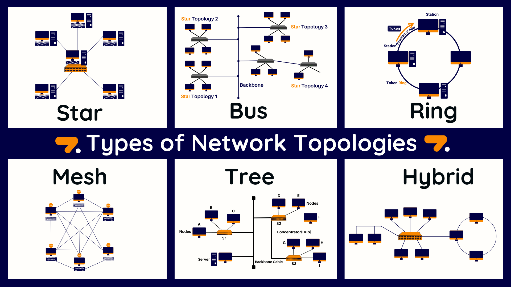
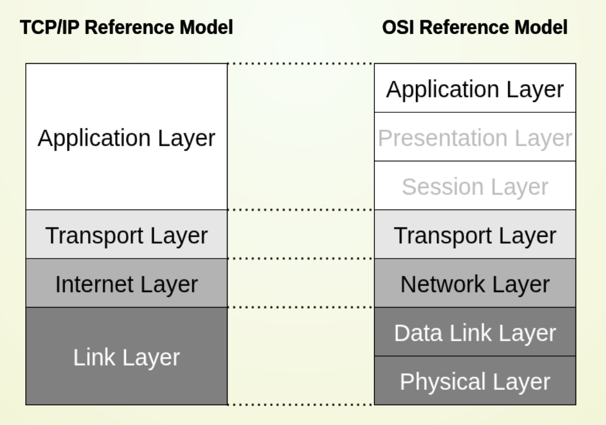

## 1. What a network needs

A network needs three things:

- **Hosts:** At least two devices running network services. A service can act as a *server* (offers a resource), *client* (uses it), or *peer* (does both). These are software roles, not fixed types of computer.
- **Transmission medium:** Copper carries electrical signals; fiber carries light. Wireless links use signals such as radio or infrared, directed toward a receiver or sent across an area.
- **Protocols:** Shared rules for connection setup, synchronization, error handling, and message encoding. *Syntax* is the message format; *semantics* is its meaning.

Networks support more than messages between hosts:

- **Resource sharing:** Use a service or resource on another machine.
- **Resource pooling:** Combine the capacity of multiple machines.
- **Resource balancing:** Distribute work or use redundancy to keep a service available.

### Size and communication pattern

| Term | Meaning |
| --- | --- |
| **PAN/BAN** | A personal or body area network, usually spanning a few meters. |
| **LAN** | A local network within a home, building, or campus. |
| **MAN** | A network connecting local networks across a metropolitan area. |
| **WAN** | A network spanning a large geographic region. |

These sizes are approximate. Communication can also be described in three ways:

- **Recipients:** *Unicast* reaches one host; *broadcast* reaches all hosts on the relevant network; *multicast* reaches a group; *anycast* reaches one member of a group.
- **Connection:** A *connection-oriented* service sets up a connection, transfers data, and closes it. A *connectionless* service sends messages without that setup. Neither label by itself guarantees reliability.
- **Direction:** *Simplex* sends one way; *half-duplex* sends both ways, one at a time; *full-duplex* sends both ways simultaneously.

## 2. How to describe performance

Three rates are easy to confuse:

- **Bandwidth:** The theoretical link capacity in bits per second.
- **Throughput:** The rate actually achieved, limited by the bottleneck along the path.
- **Goodput:** The rate of useful application data, excluding overhead and retransmissions. It is usually lower than throughput.

**Latency** is the time a message takes to arrive. A simple breakdown is:

$$\text{latency} \approx \text{propagation delay} + \text{transmission delay} + \text{waiting time}$$

$$
D_p=\frac{Distance}{Speed\ of\ light \times Velocity\ factor} \\

D_t=\frac{Message\ size}{Bandwidth}
$$

- **Propagation delay** depends on distance and signal speed in the medium.
- **Transmission delay** is message size divided by link bandwidth: the time needed to put the bits onto the link.
- **Waiting time** appears when intermediate devices queue or process traffic.

**Remember:** A faster link helps transmit a large file, but barely changes the travel time of a signal across a long distance. High bandwidth and low latency are different goals.

## 3. Network topologies
- **Physical topology:** The wiring or wireless coverage between devices.
- **Logical topology:** The path data follows. It can differ from the physical layout.
- Large networks often combine several topologies.

| Topology | Basic structure | Main trade-off |
| --- | --- | --- |
| **Bus** | All nodes share one medium. | Cheap, but the shared cable is a single point of failure and simultaneous transmissions may collide. |
| **Ring** | Each node connects to its neighbors and forwards data around the ring. | Can cover longer distances with repeaters, but a broken link can interrupt an unprotected ring. |
| **Star** | Nodes connect to a central hub or switch. | Easy to extend; a leaf failure stays local, but central equipment is critical. |
| **Mesh** | Nodes have several possible paths. | Can route around failures, at the cost of more links and routing complexity. |
| **Tree** | Stars are connected hierarchically under a root. | Scales well, but an upstream failure cuts off its subtree and the root can become a bottleneck. |
| **Cellular** | Wireless nodes communicate through base stations covering cells. | Supports mobility, but coverage and shared radio access need planning and coordination. |

Common examples:

- Switched Ethernet LANs often form a physical **star**; connected switches can form a **tree**.
- Wi-Fi and mobile networks use **cells**; routers can form a logical **mesh**.
- A shared medium needs rules for who may transmit. Wi-Fi uses mechanisms based on **CSMA/CA**.

## 4. Why networks use layers

- A **reference model** separates communication into layers. Each layer offers a service to the layer above it and follows its own protocols.
- The sender adds headers as data moves down the layers; the receiver removes them in reverse order. A link protocol may also add a trailer. This is **encapsulation**.

The practical model for Internet communication is **TCP/IP**. The **OSI model** gives a more detailed seven-layer vocabulary:

| OSI layer | Main job | TCP/IP grouping and examples |
| --- | --- | --- |
| **7 Application** | Provides network functions used by applications, such as web and email. | Application: HTTP, DNS, SMTP, SSH. |
| **6 Presentation** | Describes data formats and transformations such as encoding, compression, or encryption. | Usually handled within applications or their libraries. |
| **5 Session** | Manages dialogue or session state, potentially including checkpoints and recovery. | Usually handled within applications or their libraries. |
| **4 Transport** | Moves data between processes, identified by port numbers. | Transport: TCP and UDP. |
| **3 Network** | Uses logical addresses and routes packets between networks. | Internet: IPv4 and IPv6. |
| **2 Data link** | Sends frames across a local link, handles medium access and error detection, and uses link addresses such as MAC addresses. | Link: Ethernet and Wi-Fi. |
| **1 Physical** | Converts bits into electrical, optical, or radio signals. | The physical part of the link. |

When opening a web page, data passes through several layers:

1. **HTTP** defines the application message.
2. **TCP** (or another transport) carries data between processes.
3. **IP** routes packets between networks.
4. **Ethernet or Wi-Fi** sends frames over each local link; the physical medium carries the signals.

The link details can change at each hop. In the OSI vocabulary, a *service* is what a layer offers, an *interface* is how another layer accesses it, and a *protocol* is how peers communicate. Real software does not always split neatly into seven components.

## 5. How the Internet developed

- **1957–1969:** ARPA was founded; ARPANET began operating. Early uses included remote login, file transfer, and email.
- **1974–1980s:** Vint Cerf and Bob Kahn described the foundations of TCP/IP; the protocol suite spread widely in the 1980s.
- **1989–1990:** Tim Berners-Lee proposed the World Wide Web at CERN. The Web is an application built on the Internet.
- **Later:** Broadband, mobile devices, and connected devices expanded Internet use. Open standards and implementations helped networks interoperate and supported diversity, security, privacy, sustainability, and digital sovereignty.
