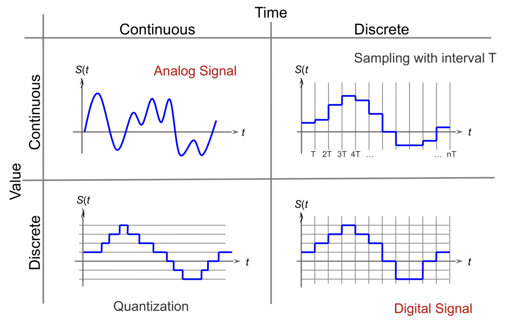
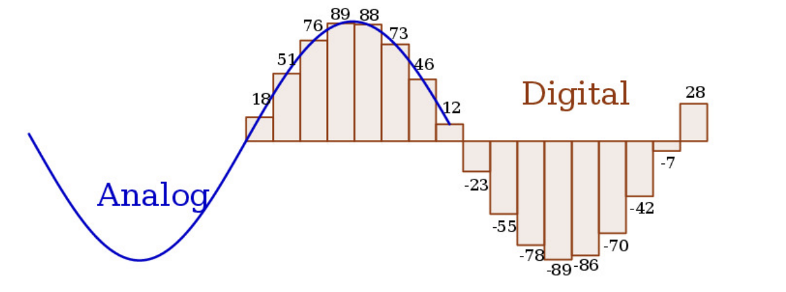

The **physical layer** turns bits into signals that can travel through a cable or through space. At the receiver, it recovers bits from those signals. Its specifications include signal encoding, the medium, and whether transmission can happen in one or both directions.

## 1. Bits, signals, and symbols

- A **signal** is a physical value that changes over time, such as voltage, light intensity, or a radio wave.
- An **analog signal** can vary continuously. A **digital signal** uses discrete values or levels.
- A network interface converts between the device's data and the signal carried by the channel.

A periodic signal is described by:

- **Amplitude:** The signal's strength or height.
- **Period $T$:** The time for one cycle.
- **Frequency $f$:** Cycles per second, with $f=1/T$.
- **Phase:** Where the cycle starts relative to a reference.

For an analog input:
- **sampling** measures it at regular times
- **quantization** maps each measurement to one of a finite set of levels
- **coding** assigns a bit pattern to each level.

>Digital data sent through a physical medium also needs a mapping from bits to signal states.

### Bit rate and symbol rate

**Bit rate** counts bits per second (bit/s).

**Symbol rate** counts transmitted signal states per second (baud).

A symbol with $V$ possible states can represent up to $\log_2 V$ bits.

$$
\text{Bit Rate}=\text{Symbol Rate}\times\log_2(V)
$$

> For example, four distinct states can represent two bits per symbol.

#### Hartley's Law

$$
C=2H\log_2(V)
$$

Where $C$ is the maximum data rate (bit/s), $H$ is the channel bandwidth (Hz), and $V$ is the number of different symbol levels.

## 2. Why a channel has limits

Real media change the signal before it reaches the receiver:

- **Attenuation** weakens the signal over distance. If it becomes too weak, the receiver cannot reliably identify the symbols.
- **Noise** adds unwanted variation. Examples include thermal noise, crosstalk from nearby wires, and short impulses.
- **Distortion** changes the signal's shape or timing; echoes and different delays for different frequencies are examples.
- **Bit error rate (BER)** is the number of erroneous bits divided by the number of transmitted bits.

Increasing transmission power can help, but it uses more energy and may interfere with other users of a shared medium.

Three ideas explain the data-rate limit:

- **Ideal channel:** With frequency bandwidth $B$ and $V$ distinguishable symbol levels, the Nyquist limit is $2B\log_2 V$ bit/s. Adding levels appears to increase the rate, but only while the receiver can tell them apart.
- **Finite frequency bandwidth:** A channel passes only a range of frequencies well. A square wave contains a fundamental frequency plus higher harmonics. If the medium removes those harmonics, the edges become rounded and bits are harder to recover.
- **Noise:** Even with more symbol levels, nearby levels eventually become indistinguishable. The Shannon–Hartley limit for channel bandwidth $B$ and signal-to-noise ratio $S/N$ is $C=B\log_2(1+S/N)$ bit/s. A larger $B$ or cleaner signal raises the theoretical maximum.

Here **frequency bandwidth** is measured in hertz; **data rate** is measured in bits per second. They are related, but they are not the same unit.

## 3. Encoding and modulation

**Line encoding** maps bits directly to changes in a baseband signal. A useful scheme must balance efficiency, resistance to distortion, and synchronization between sender and receiver.

| Line code | How it represents bits | Main trade-off |
| --- | --- | --- |
| **NRZ** | Uses one signal level for 0 and another for 1. | Simple, but a long run of identical bits has no transition for clock recovery and can cause baseline drift. |
| **Manchester** | Uses a transition in the middle of each bit; its direction represents 0 or 1. | The regular transitions help synchronization, but use more signaling bandwidth. |

**Modulation** changes a carrier signal to represent data. Different carrier frequencies can share a medium, as in broadband systems. A modem performs modulation and demodulation.

| Method | What changes | Main point |
| --- | --- | --- |
| **ASK** | Amplitude | Simple, but changes in signal strength can be mistaken for data. |
| **FSK** | Frequency | Uses distinct frequencies, which needs more frequency bandwidth. |
| **PSK** | Phase | Can resist some distortion, but requires more involved demodulation. |

**Baseband** sends the encoded signal directly over the available channel. **Broadband** uses a carrier and modulation, often allowing several frequency channels at once. The exact implementation depends on the network technology.

## 4. Transmission media

**Guided media** confine the signal to a physical path:

- **Coaxial cable:** An inner conductor carries electrical signals; an outer grounded conductor shields it from interference.
- **Twisted pair:** Pairs of wires are twisted to reduce interference and crosstalk. Shielded variants add foil or braid. Cable categories indicate different performance limits, but the lowest rated component limits the whole link.
- **Optical fiber:** Light travels through glass. Fiber supports high data rates over long distances and is immune to electromagnetic interference. Cabling and optical equipment can cost more than copper.

**Unguided media** carry electromagnetic waves through space. Wireless range depends on transmit power, obstacles, interference, and the environment. The radio spectrum is shared and frequencies must be allocated; access rules are needed when several devices want to transmit.

### The last mile

The **last mile** connects a home or organization to a provider's network. Common approaches reuse different infrastructure:

- **DSL:** Uses telephone copper pairs; performance depends strongly on line length and quality.
- **Cable/DOCSIS:** Uses cable-TV coax, often with fiber closer to the neighborhood; users can share access capacity.
- **Cellular:** Uses a mobile operator's radio network, from earlier generations to LTE and 5G.
- **Fiber:** Extends an optical connection toward the customer.
- **Other options:** Fixed wireless, satellite, or power-line links where appropriate.

Older dial-up modems carried digital data as audio-band signals over telephone lines. They are a useful example of why the medium and its available frequency range constrain the achievable rate.

## 5. Ethernet and Wi-Fi

Standards make equipment from different vendors interoperable. The IEEE 802 family includes **802.3 Ethernet** and **802.11 wireless LAN**. Both cover physical-layer details and parts of the data-link layer.

- **Ethernet** began with shared coaxial cable and later adopted twisted-pair and fiber links. Modern wired LANs commonly connect devices to switches.
- **Wi-Fi** is based on IEEE 802.11. In *infrastructure mode*, clients use an access point; *ad-hoc mode* connects devices directly.
- Wi-Fi channels can overlap. In the 2.4 GHz band, careful channel selection matters when nearby networks compete for radio time.
- Wireless links must handle interference and shared access. Security is a separate concern: **WEP is obsolete**; the slides introduce the later WPA family, including WPA2 and WPA3.

