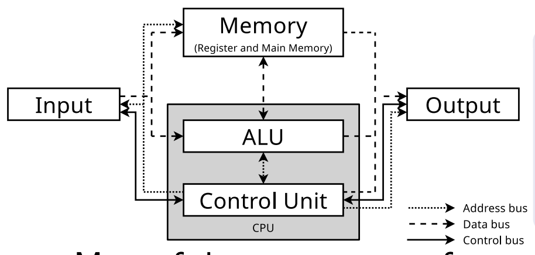
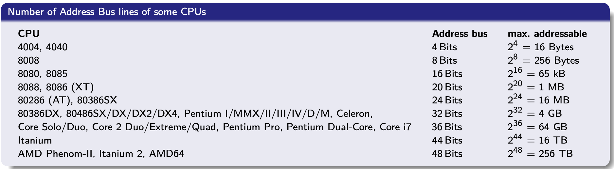
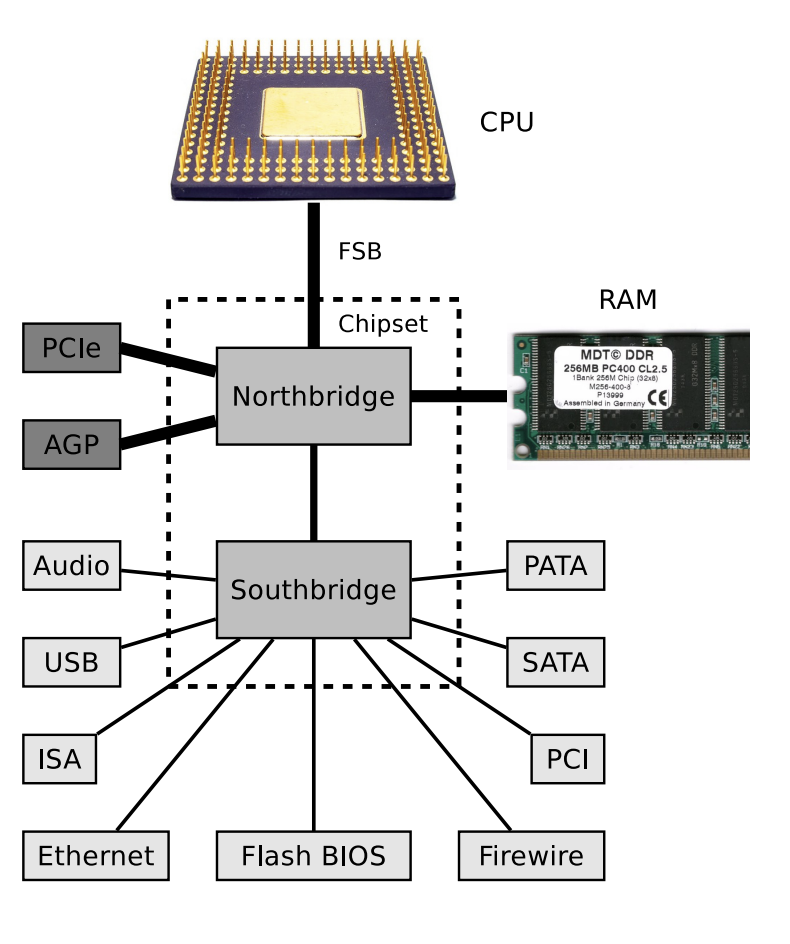
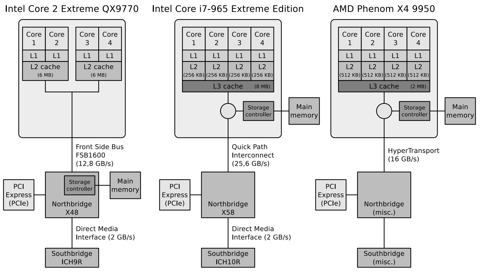
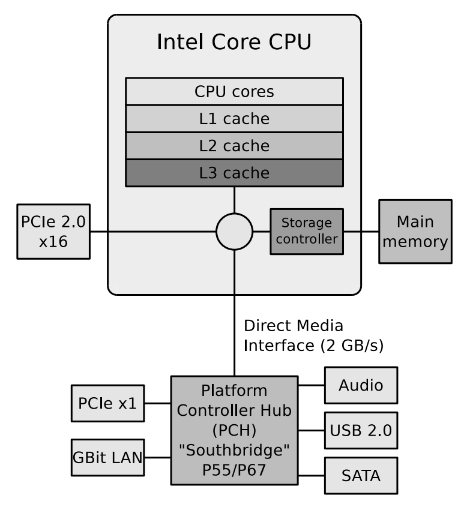
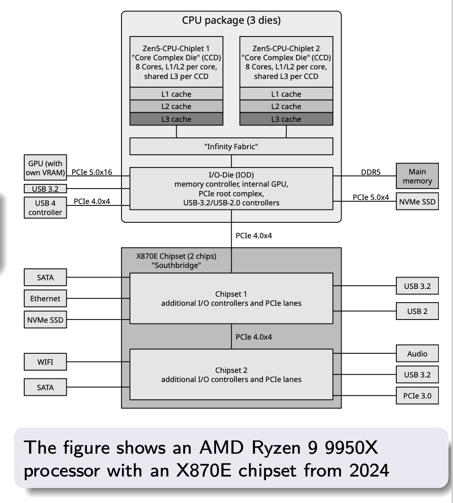
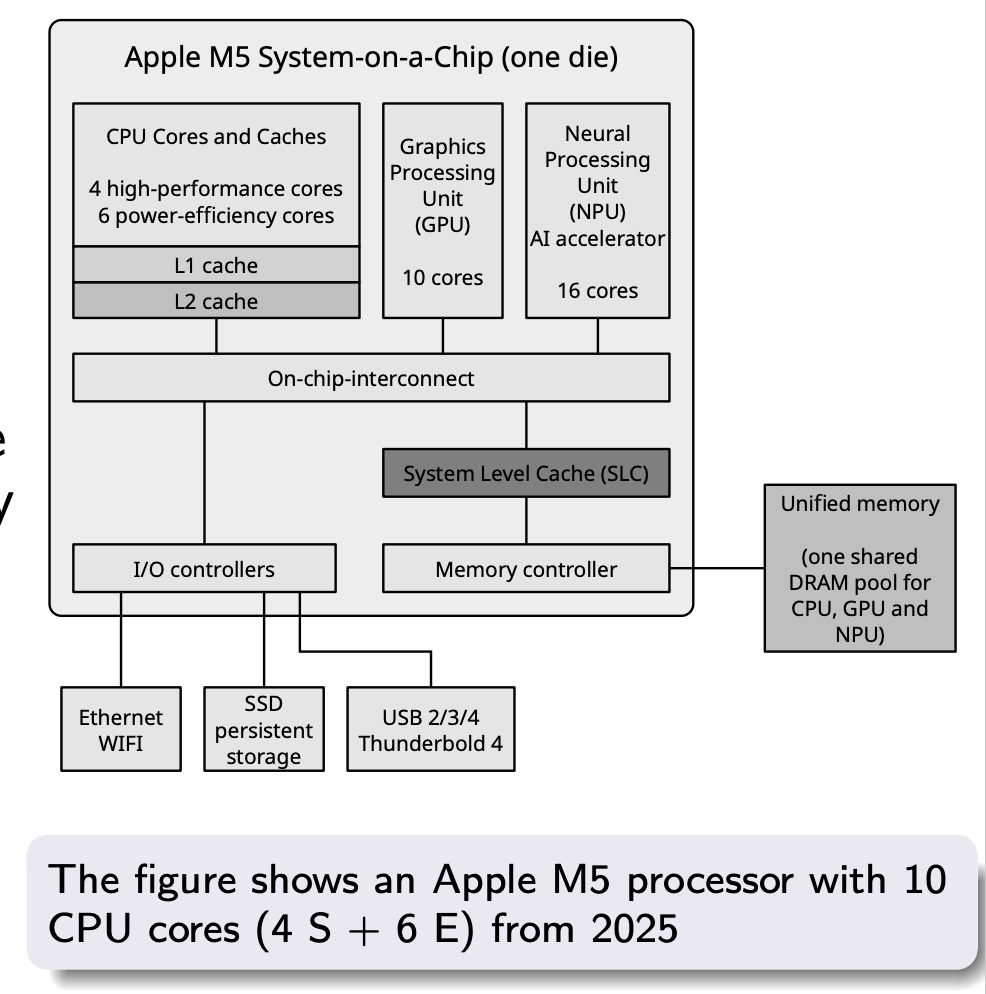
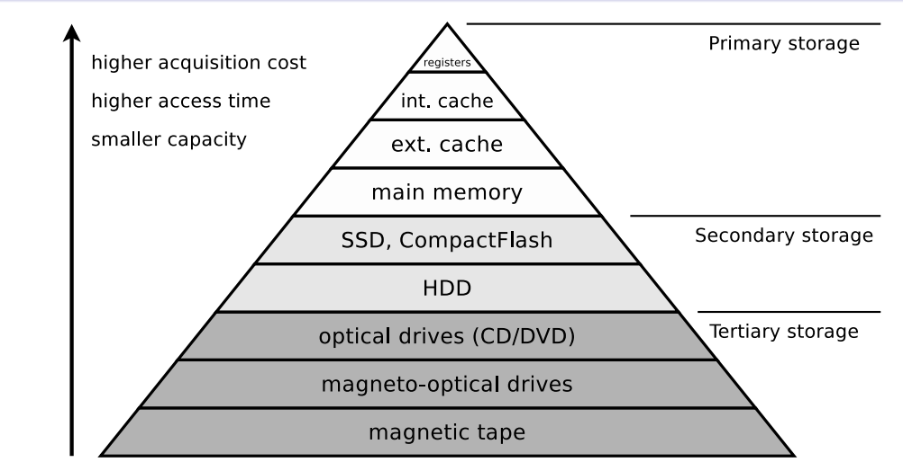

## 1. The basic computer model

**Von Neumann architecture**: a general-purpose computer where both programs and data are encoded in binary and kept in memory (RAM).

A program is not a special physical object. It is data that the CPU interprets as instructions.

A current CPU contains several cores, caches, memory controllers, and often graphics or AI components in the same package.

### What the CPU does

Two parts are central:

- The **control unit** interprets instructions and coordinates CPU components, I/O activity, and control signals.
- The **arithmetic logic unit (ALU)** performs arithmetic and logical operations such as addition, subtraction, AND, OR, XOR, and NOT.

The CPU also has extremely fast local storage: **registers**. Registers keep operands, addresses, the current instruction, and control state close to the execution units.

### The instruction cycle

At a simplified level, the CPU repeats the following cycle from boot until shutdown:

1. **Fetch** the next instruction from memory into the instruction register.
2. **Decode** it: the control unit determines what operation is required.
3. **Fetch operands**, if the instruction needs input values.
4. **Execute** the operation in the ALU or another execution unit.
5. **Update the program counter** so it points to the next instruction.
6. **Write back** the result to a register, memory, or an output device.

The important OS connection is that a running process is represented partly by this CPU state. During a context switch, the operating system must preserve enough state, such as registers and the program counter, for the process to continue later as if it had never stopped.

## 2. Buses: moving addresses, data, and commands

A **bus** is a communication path between components. The classical model distinguishes three kinds of signals:

| Bus | Carries | Why the OS cares |
| --- | --- | --- |
| **Data bus** | The values being transferred. | It moves instructions, file contents, network packets, and device data. |
| **Address bus** | The address of a memory location or I/O device. | It determines what memory or device a CPU operation refers to. |
| **Control bus** | Requests and status signals, including interrupts. | It lets the CPU command devices and lets devices notify the CPU. |

The width of the data bus affects how much data can be transferred at once. The width of the address bus constrains how many addresses can be represented: with $n$ address lines, the theoretical maximum is $2^n$ addressable locations.

Modern machines no longer resemble a single CPU connected to every device by one shared bus. They use specialized, often point-to-point, links such as PCI Express, SATA, USB, and Ethernet. Device controllers sit between the CPU and devices, translating generic OS driver requests into device-specific work.

### From chipset to integrated controllers

Older PC designs commonly used a **northbridge** for fast connections such as main memory and graphics, plus a **southbridge** for slower I/O.

The bus between CPU and chipset is called **Front Side Bus (FSB)**, It contains the address bus, data bus and control bus

#### Some Bus Systems

For performance and financial reasons, more and more parts of
the chipset are relocated into the CPU
- In contrast to the Von Neumann architecture, I/O devices are not directly connected to the CPU
- Computer systems today contain various serial and parallel bus systems, which are designed for the particular requirements
- Point-to-point connections are used more and more often
- Controllers for I/O devices operate between the devices and the CPU

|  | Internal computer busses | External computer busses |
| --- | --- | --- | 
| **Parallel busses** | PATA (IDE), PCI, ISA, SCS | PCMCIA, SCSI | 
| **Serial busses** | SATA, PCI-Express | Ethernet, FireWire, USB, eSATA |

Over time, memory controllers and PCIe functions moved into the processor package. Current processors may use chiplets, an I/O die, or a system-on-a-chip design.

### Relocation of the Memory Controller into the CPU

>Result: The Northbridge contains only the PCIe controller

### Relocation of the Northbridge into the CPU
In modern computer systems, the Northbridge is relocated into the CPU. Since this time, the Southbridge is also called Platform Controller Hub (PCH)
>Benefit: Reduced cost for the overall
system

### Modern Architecture: Chiplets and Integrated Controller
The slide uses the AMD Ryzen 9 9950X as an example. Instead of placing all functions on a single silicon block, the processor package can include multiple chiplets.

CPU chiplets contain cores and cache. A separate I/O Die (IOD) contains controllers such as the memory controller, PCIe, and USB.

> one chiplet (e.g., Ryzen 7 9700X), two chiplets (e.g., Ryzen 9 9950X), 12 chiplets (e.g., Threadripper PRO 7995WX or even 16 chiplets (e.g., EPYC 9755 (Zen 5))

### Unified Memory

The CPU, GPU, and NPU of Apple silicon share a common RAM area called Unified Memory. This eliminates the need to copy data back and forth between separate memory areas, reducing overhead and power consumption.

## 3. Input/Output Devices

### Character Devices vs. Block Devices

I/O devices are classified by their **minimum transfer unit**.

- **Character Devices:**
  - Transfer data character by character.
  - Communicate with the CPU for each character.
  - Examples: Keyboard, mouse, printer, terminal, magnetic tape.

- **Block Devices:**
  - Transfer data in complete blocks (e.g., 1–4 KB).
  - Examples: HDD, SSD, CD/DVD drive, floppy drive.

### Reading Data

Steps to read data from an HDD:

1. CPU receives a read request from a process.
2. CPU sends an I/O command via the **device driver** to the **controller**.
3. Controller locates the requested data on the HDD.
4. Process receives the requested data.

**Three I/O methods:**
- Busy Waiting
- Interrupt-driven I/O
- Direct Memory Access (DMA)

## Busy Waiting

- The driver sends a request and continuously checks whether the data is ready (**polling**).
- Once ready, data is transferred into memory.
- Example: **Programmed I/O (PIO)**, CPU copies data between devices and main memory.

**Advantage:**
- No additional hardware required.

**Disadvantages:**
- Wastes CPU time while waiting.
- Slows down multitasking.

### Interrupt-driven I/O

- Requires an **interrupt controller** and a control bus line.
- Driver starts an I/O operation and waits (sleeps).
- CPU can execute other processes while waiting.
- When data is ready, the controller sends an **interrupt**.
- CPU reads data from the controller into memory, then the waiting process can continue.

**Advantages:**
- CPU is not blocked while waiting.
- Supports multitasking.

**Disadvantage:**
- Requires additional hardware (interrupt controller).

### Direct Memory Access – DMA

- Requires a **DMA controller**.
- Transfers data directly between an I/O device and main memory.
- CPU does not need to copy individual data words.
- An interrupt is triggered after the transfer is completed.
- Examples: HDD/SSD, sound card, network adapter.
- Example protocol: **Ultra-DMA (UDMA)**, successor to PIO.

**Advantage:**
- Reduces CPU workload during data transfer.

**Disadvantage:**
- Requires additional hardware (DMA controller).

## 5. Storage is a hierarchy, not one thing

“Memory” can mean several different layers. The reason is a price-performance trade-off: storage that is faster is usually more expensive per byte and smaller in capacity.

| Layer | Typical role | Speed and capacity intuition |
| --- | --- | --- |
| Registers | Current operands, addresses, and execution state. | Fastest and smallest; inside the CPU. |
| Cache (L1/L2/L3) | Copies of recently or frequently used main-memory data. | Very fast, limited capacity. |
| Main memory (DRAM) | Active programs and their data. | Larger, slower than cache, volatile. |
| Secondary storage | Persistent files and executables on SSDs or HDDs. | Much larger and slower than RAM. |
| Tertiary storage | Long-term archive media. | Often removable or only connected when needed. |

**Primary storage** is directly accessible by the CPU, while **secondary storage** is accessed through a controller. **Tertiary storage** is mainly for archiving. It may be near-line, where a system connects it automatically, or off-line, where a person must insert or connect the medium.

### Volatile and non-volatile storage

**Volatile Memory (loses data without power):**
- **SRAM (Static RAM):**
  - Stores data using flip-flop circuits.
  - Faster and more expensive than DRAM.
  - No periodic refresh required.
  - Used for CPU cache and registers.
- **DRAM (Dynamic RAM):**
  - Stores data in capacitors.
  - Requires periodic refreshing.
  - Used for main memory (RAM).

**Non-volatile Memory (retains data without power):**
- **ROM (Read-Only Memory):** Includes EEPROM.
- **Flash Memory:** Used in SSDs, USB drives, and memory cards.

### Storage Technologies

- **Mechanical:** Punch cards, punched tapes, CD/DVD (pressed media).
- **Magnetic:** HDDs, magnetic tapes, floppy disks.
- **Magneto-optical:** Magnetic writing with laser heating, optical reading.
- **Electric:** SRAM, DRAM, Flash memory.

**Access methods:**
- **Sequential Access:** Data must be searched sequentially (e.g., magnetic tape).
- **Random Access:** Data can be accessed directly without searching from the beginning (e.g., HDD, SSD, RAM).

### Functioning of the Memory Hierarchy

- When data is accessed for the first time, a **copy moves upward** through the memory hierarchy.
- Higher storage levels contain copies of data from lower levels.
- When data is modified, changes must eventually be **written back** to lower levels.
- Copies must be updated to avoid **inconsistencies**.
- Since cache capacity is limited, old data must sometimes be replaced.

### Cache Write Policies

**Write-through:**
- Changes are immediately written to lower storage levels.
- **Advantage:** Ensures data consistency.
- **Disadvantage:** Lower performance due to immediate writing.

**Write-back:**
- Changes are initially written only to the cache.
- Modified data is written to lower storage when the corresponding cache entry is removed.
- Uses a **Dirty Bit** to indicate modified data.
- **Advantage:** Better performance.
- **Disadvantage:** Unsaved changes may be lost during a system failure.

| Write-through | Write-back |
|---|---|
| Immediate write | Delayed write |
| Better consistency | Better performance |
| Slower | Risk of losing unwritten data |

### Registers, Cache and Main Memory

**Registers:**
- Fastest storage, located inside the CPU.
- Operate at CPU speed.
- Types:
  - **Data Registers:** Store operands and results.
  - **Address Registers:** Store memory addresses.
  - **Program Counter (PC):** Address of the next instruction.
  - **Instruction Register (IR):** Currently executed instruction.
  - **Stack Pointer (SP):** Address of the current stack top.

**Cache Memory:**
- Stores copies of frequently or recently accessed RAM data.
- Reduces memory access time.
- Cache levels:
  - **L1:** Fastest and smallest.
  - **L2:** Larger but slower than L1.
  - **L3:** Larger and usually shared between CPU cores.
- In the multicore architecture described in the slides, each core has its own L1/L2 cache and shares L3.

**Main Memory (RAM):**
- Uses DRAM.
- Larger but slower than cache.
- Stores active programs and data.
- CPU requests not satisfied by cache are forwarded to RAM.
- Volatile: Data is lost when power is removed.
